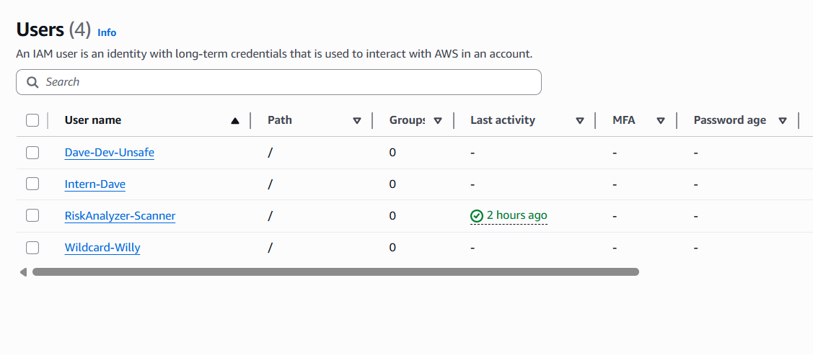
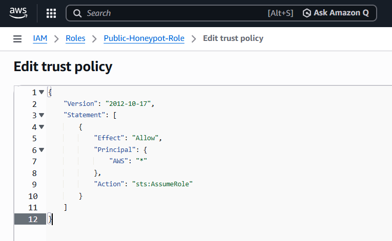
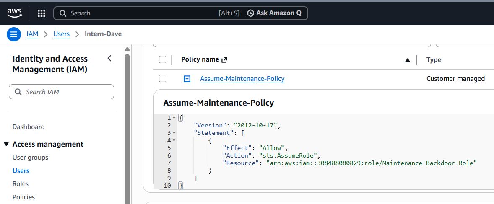
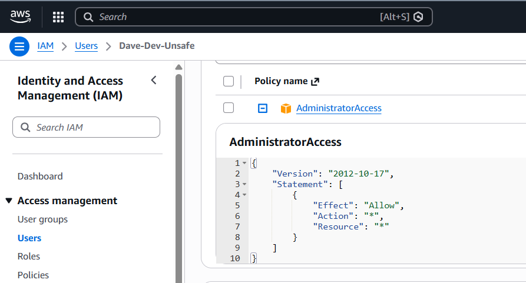
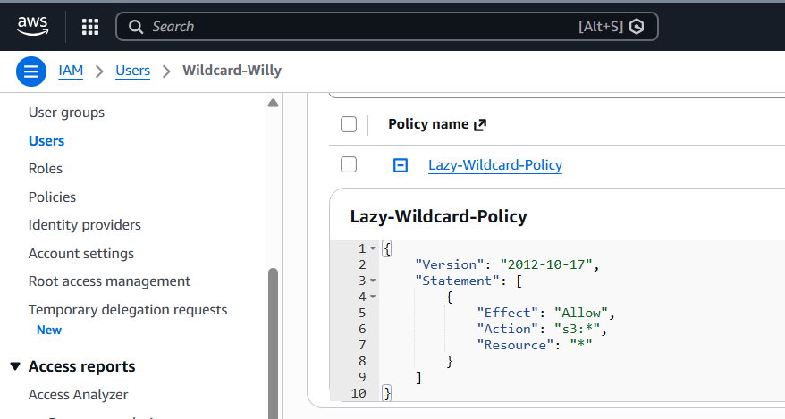
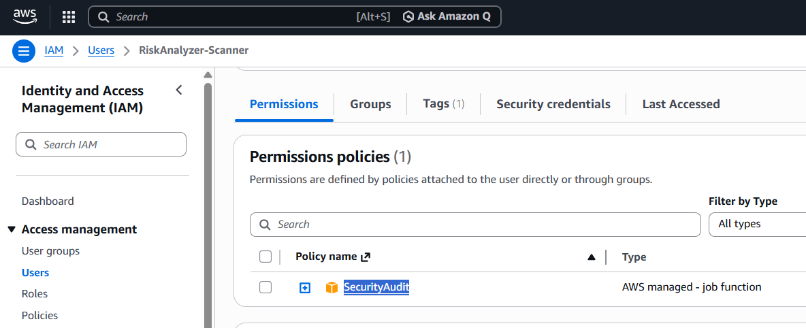
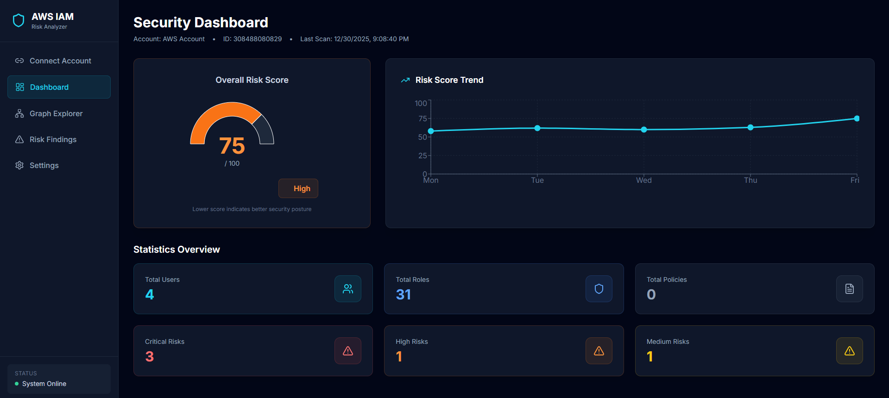

#  CloudLens: Proof of Concept & AWS Case Studies

This document provides a detailed walkthrough of the AWS environment used to validate the **CloudLens** risk engine. It demonstrates the "Truth in the Console" versus the "Intelligence in the Dashboard."

---

## 🔬 Case Study 1: The Public Entry Point
**Vulnerability:** Publicly Assumable Role  
**AWS Evidence:** A role named `Public-Honeypot-Role` was configured with a Trust Policy allowing `Principal: "*"`.

> **CloudLens Result:** The engine identifies the `*` principal in the trust policy (whether written as `"*"` or `{"AWS": "*"}`) and flags this as a **CRITICAL** risk. In the Graph Explorer, this role is linked to an **"Anyone (Public)"** node.

---

## ⛓️ Case Study 2: Hidden Privilege Escalation
**Vulnerability:** Role Chaining / Lateral Movement  
**AWS Evidence:** A low-level user `Intern-Dave` is granted `sts:AssumeRole` permissions on a high-privilege maintenance role.

> **CloudLens Result:** While a manual auditor might miss this single line of JSON, CloudLens draws a `CAN_ASSUME` edge from the user to the role, provided the role's trust policy lets Dave in: either by naming him directly, or by trusting the account while Dave's effective permissions allow `sts:AssumeRole` on that role. Because the role has admin, the shortest-path search reports a **CRITICAL** *Privilege Escalation Path* finding, e.g. `Path to admin: Intern-Dave -> Maintenance-Role [CAN_ASSUME]`, and highlights the chain in the graph.

---

## 🔓 Case Study 3: The "Lazy" Administrator
**Vulnerability:** Full Admin Access & Security Hygiene  
**AWS Evidence:** User `Dave-Dev-Unsafe` has the managed `AdministratorAccess` policy attached directly, but **MFA is NOT enabled**.

> **CloudLens Result:** Our engine runs dual-logic checks. It flags the user for **Critical Excessive Permissions** (based on effective `*:*` permissions, so the same applies to admin granted through a group or a custom policy) and generates a **High Security Hygiene** finding for the missing MFA, using the IAM credential report.

---

## 🟠 Case Study 4: Broad Service Wildcards
**Vulnerability:** Over-permissive Resource Access  
**AWS Evidence:** User `Wildcard-Willy` has an inline policy allowing `s3:*` on all resources (`*`).

> **CloudLens Result:** CloudLens parses the `Action` and `Resource` fields. Because the action is a service wildcard (`s3:*`) rather than a specific action, it is categorized as a **HIGH** risk finding.

---

## 🛡️ Case Study 5: The Zero-Trust Scanner
**Security Model:** Least Privilege Execution  
**AWS Evidence:** The `RiskAnalyzer-Scanner` identity (used by this tool) is strictly limited to the AWS-managed **`SecurityAudit`** policy. Its credentials live in a local AWS profile on the backend machine; the dashboard only selects the profile by name.

> **CloudLens Result:** This demonstrates the tool's privilege model. It cannot modify or delete any resources in the target environment; the only thing it asks AWS to generate is the IAM credential report, which it reads.

---

## 📋 Target Environment Summary
The following identities were used to generate the 75/100 Risk Score seen in the demonstration:

---

*Return to [Main README.md](README.md)*
