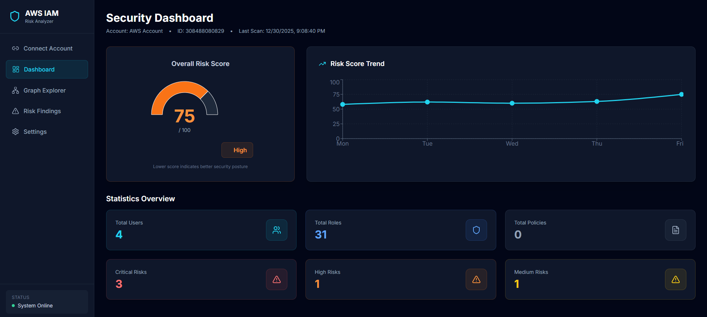
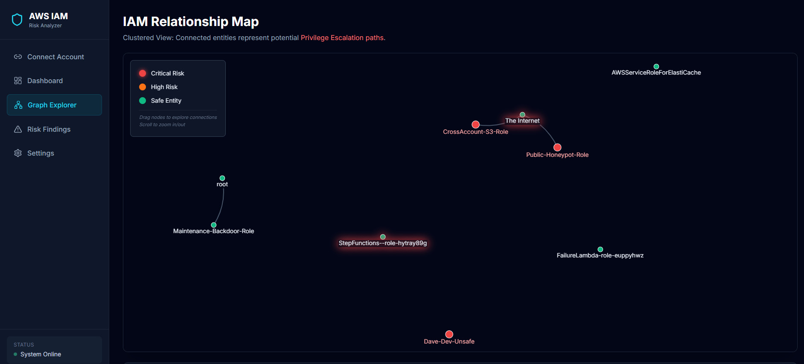
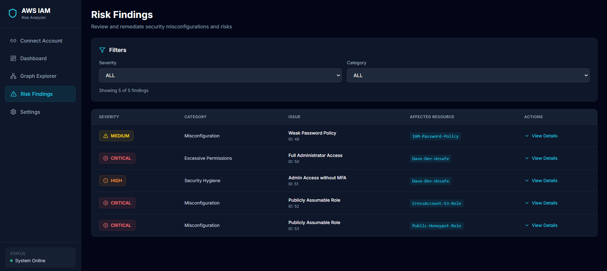
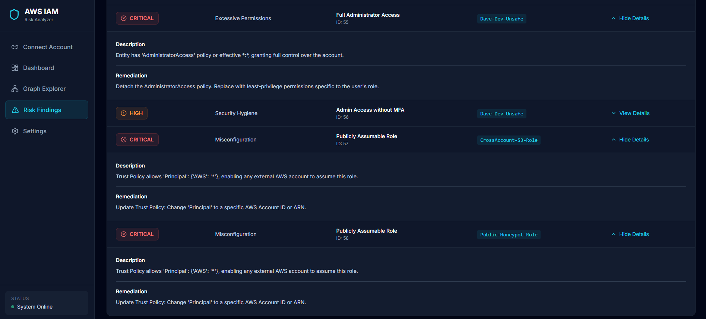
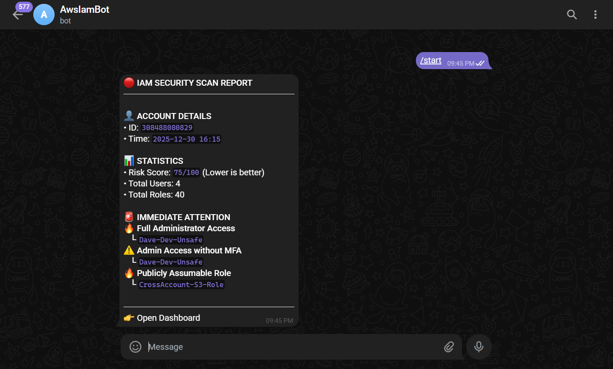
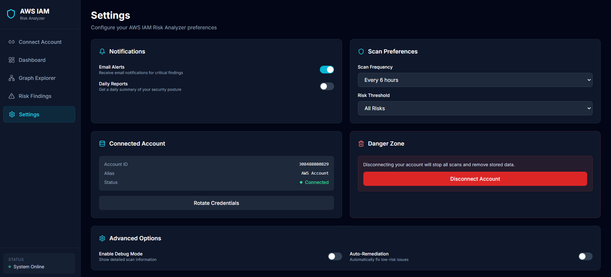
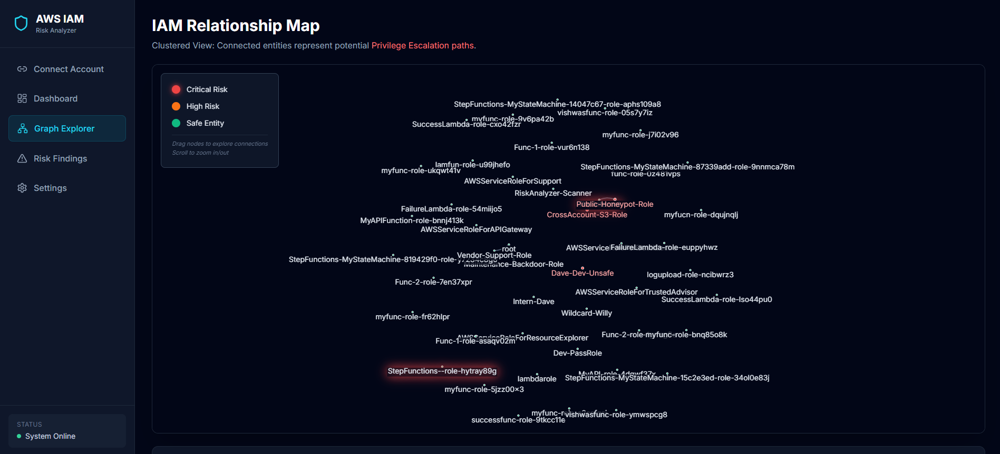

# 🛡️ CloudLens: AWS IAM Risk & Attack Path Analyzer

**CloudLens** is a local, self-hosted tool that analyzes AWS IAM configurations, detects dangerous misconfigurations, and finds privilege-escalation paths between identities.

Instead of a flat list of findings, CloudLens builds a graph of who can reach whom in your account and shows the shortest chain from each non-admin identity to full admin.

---

## 🌟 Core Capabilities

### 🔍 **Effective-Permission Analysis**
Reads IAM users, groups, roles and policies with Boto3 and evaluates each identity's *effective* permissions (inline, managed and group policies combined, with explicit Deny applied), rather than matching policy names.

### 🗺️ **Attack Path Mapping**
Models trust relationships and IAM escalation techniques as graph edges, then searches for the shortest path from every non-admin identity to admin. Each path is reported hop by hop and highlighted in the graph.

### ⚖️ **Weighted Risk Score**
Produces a risk score from **0 to 100** (lower is better): 20 points per Critical, 10 per High and 5 per Medium finding, capped at 100.

### 🚨 **Optional Telegram Notifications**
If configured, sends a short scan summary to a Telegram chat when a scan finishes.

### 🔒 **Self-Hosted**
The backend and dashboard run on your machine. AWS credentials stay in your local AWS profile and are never sent to the browser. See **Security & Privacy Model** below for exactly what leaves your environment.

---


## 🖼️ Visual Showcase

<div align="center">
  <p><b>Main Security Dashboard</b></p>
  
  <br><br>
  <p><b>Interactive Attack Path Graph</b></p>
  
  <br><br>
  <p><b>Risk Findings Overview</b></p>
  
  <br><br>
  <p><b>Risk Findings Details</b></p>
  
  <br><br>
  <p><b>Telegram notify alert </b></p>
  
  <br><br>
  <p><b>other</b></p>
  
  
</div>


---

## 🚨 PROOF OF CONCEPT NOTICE

**THIS PROJECT HAS BEEN VALIDATED AGAINST A LIVE AWS ENVIRONMENT.**

### 👉 [PLEASE REFER TO AWS-README.MD](./AWS-README.md) 
**FOR FULL DOCUMENTATION OF THE MISCONFIGURATIONS DETECTED, CORRESPONDING AWS CONSOLE SCREENSHOTS, AND ATTACK-PATH CASE STUDIES.**

---


## 🏗️ Project Architecture

This repository links the two services as **Git Submodules**.

```text
CloudLens-IAM/ (Main Hub)
├── AWS-IAM-backend/      # Django API, AWS collection, policy engine, attack-path analysis (Submodule)
├── AWS-IAM-frontend/     # React dashboard (Submodule)
├── AWS-README.md         # Case studies against a live AWS account
└── README.md             # You Are Here
```

## 🛠️ Tech Stack

- **Backend:** Python, Django + Django REST Framework, Boto3 (AWS SDK), SQLite.
- **Analysis Engine:** custom IAM policy evaluator, NetworkX (graph + shortest paths).
- **Frontend:** React 18, TypeScript, Vite, Tailwind CSS.
- **Visuals:** React-Force-Graph (D3-based physics), Recharts.

---

## 🚀 Quick Start (Local)

**Prerequisites:** Python 3.11+, Node.js 18+, Git, and an AWS account where you can create a read-only identity.

### 1. Clone the Project (Recursive)
The backend and frontend are submodules, so clone with `--recursive`:
```bash
git clone --recursive https://github.com/vishwas-adhikari/CloudLens-IAM.git
cd CloudLens-IAM
```
*If you already cloned normally, run `git submodule update --init --recursive`.*

### 2. Create a Read-Only AWS Profile
CloudLens never asks for keys in the browser. It scans with a named profile from your local AWS config.

1. In IAM, create a dedicated identity (for example a user named `cloudlens-audit`) and attach **only** the AWS-managed **`SecurityAudit`** policy.
2. Add its credentials as a profile on the machine that runs the backend:
   ```bash
   aws configure --profile cloudlens-audit
   ```
   or edit `~/.aws/credentials` directly:
   ```ini
   [cloudlens-audit]
   aws_access_key_id = AKIA...
   aws_secret_access_key = ...
   ```
   SSO and `role_arn` profiles in `~/.aws/config` work too. Every profile appears in the dashboard's dropdown, along with "Default credential chain" (environment variables, instance role, etc.).

### 3. Run the Backend
```bash
cd AWS-IAM-backend
python -m venv venv
source venv/bin/activate          # Windows: venv\Scripts\activate
pip install -r requirements.txt

cp .env.example .env              # Windows: copy .env.example .env
# Edit .env: set DEBUG=True for local development and any SECRET_KEY.
# Optional Telegram alerts: add TELEGRAM_BOT_TOKEN=... and TELEGRAM_CHAT_ID=...

python manage.py migrate
python manage.py runserver        # http://localhost:8000
```

### 4. Run the Frontend
In a second terminal:
```bash
cd AWS-IAM-frontend
npm install
npm run dev                       # http://localhost:5173
```
The frontend calls `http://localhost:8000` by default. To point it elsewhere, set `VITE_API_URL` (for example in `AWS-IAM-frontend/.env.local`).

### 5. Scan
Open [http://localhost:5173](http://localhost:5173), pick your profile and click **Start Security Scan**.

### 6. Run the Tests
```bash
cd AWS-IAM-backend
python manage.py test             # backend unit tests (no AWS calls; AWS responses are stubbed)

cd ../AWS-IAM-frontend
npm run typecheck                 # TypeScript checks
npm run build                     # production build
```

---


## 🔎 Risk Engine Breakdown

### Effective-permissions model
Every check runs against an identity's **effective permissions**, not against policy names:

- A user's permissions combine its inline policies, attached managed policies (customer- and AWS-managed, with documents fetched from AWS) and the inline + managed policies of every group it belongs to. A role combines its inline and attached policies.
- Actions match case-insensitively with IAM wildcards (`*`, `iam:*`, `iam:Attach*`); `NotAction` and `NotResource` are supported, and checks use the specific resource ARN involved, so a policy scoped to other resources doesn't count.
- An explicit Deny overrides any Allow. An identity with `*:*` still counts as admin under a narrow Deny it could remove itself, unless a Deny also blocks the IAM actions needed to remove it.
- How Conditions and other policy types are treated is covered under **Limitations** below.

### Findings

| Severity | Risk Pattern | Security Impact |
| :--- | :--- | :--- |
| 🟥 **CRITICAL** | **Full Admin Access** | Identity's effective permissions allow every action on every resource (`*:*`), from any source: `AdministratorAccess`, a custom policy, or a group. |
| 🟥 **CRITICAL** | **Public Trust** | Role trust policy allows `Principal: "*"` (any AWS principal can try to assume it). |
| 🟥 **CRITICAL** | **Privilege Escalation Path** | A non-admin identity can reach admin through a chain of the edges below. The finding lists every hop. |
| 🟧 **HIGH** | **No-MFA Admin** | Admin user without MFA, per the IAM credential report (falls back to `ListMFADevices`). |
| 🟧 **HIGH** | **Service Wildcards** | Effective service-wide grants like `s3:*` or `ec2:*` on all resources. |
| 🟨 **MEDIUM** | **PassRole on Any Role** | `iam:PassRole` allowed on `*`. |
| 🟨 **MEDIUM** | **Weak Password Policy** | No account password policy, or a minimum length below 14 characters. |

### Attack-path edges
The graph links identities with these edges. Each one is only added when the source's effective permissions allow it on that specific target:

| Edge | From → To | Meaning |
| :--- | :--- | :--- |
| `CAN_ASSUME` | principal → role | The role's trust policy names the principal directly, or trusts the account and the principal is allowed `sts:AssumeRole` on that role. Also drawn from external accounts, AWS services, federated providers and public `*`. |
| `CAN_SELF_ESCALATE` | principal → Account Admin | The principal can grant itself admin: attach or write a policy on itself, publish a new version of a customer-managed policy it already has, join a group that has admin, or write a policy onto a group it is in. |
| `CAN_TAKE_OVER` | principal → user | The principal can obtain working credentials for another user (`iam:CreateAccessKey`, `iam:CreateLoginProfile`, `iam:UpdateLoginProfile`). |
| `CAN_MODIFY_TRUST` | principal → role | The principal can rewrite the role's trust policy (`iam:UpdateAssumeRolePolicy`) to let itself in. |
| `CAN_PASS_ROLE` | principal → role | The principal can pass the role to compute and run code as it: `iam:PassRole` plus `lambda:CreateFunction` + `lambda:InvokeFunction` for roles trusting Lambda, or `ec2:RunInstances` for roles trusting EC2. |

### Shortest-path search
For every non-admin user and role (plus public and external-account entry points), CloudLens runs a breadth-first shortest-path search over these edges to any admin identity or the Account Admin node. Each path becomes one **Privilege Escalation Path** finding, for example:

```text
Path to admin: Intern-Dave -> Maintenance-Role [CAN_ASSUME]
```

The hops are stored with the finding, every node on a path is marked Critical in the graph, and **View path in graph** on the Risk Findings page highlights the chain.

---

## ⚖️ Compared with PMapper / Prowler / IAM Access Analyzer

| Tool | What it does | Overlap with CloudLens | Where CloudLens differs |
| :--- | :--- | :--- | :--- |
| **PMapper** (NCC Group's Principal Mapper) | Open-source Python CLI that builds a graph of IAM principals and the edges by which one can gain another's access, then answers "who can do X?" and privilege-escalation queries. | Same core idea: an identity graph with escalation edges and path search. | PMapper models more edge types, and its policy simulator also considers some resource policies and, with AWS Organizations data, SCPs. CloudLens covers fewer techniques but adds a web dashboard, saved scan history, a risk score and hygiene checks such as MFA and password policy. |
| **Prowler** | Open-source security posture tool with hundreds of checks across AWS and other clouds, mapped to compliance frameworks such as CIS. | IAM hygiene checks (admin policies, MFA, password policy, wildcards), including flagging individual policies that allow known escalation actions. | Prowler covers far more services and compliance reporting. CloudLens focuses on IAM only and chains permissions across identities into multi-hop paths. |
| **IAM Access Analyzer** (AWS service) | Uses automated reasoning to find resources shared outside your account or organization; also offers unused-access findings, policy validation and policy generation. | Both flag roles whose trust policies let outside principals in. | Access Analyzer covers resource policies across many services and reasons about Conditions formally. CloudLens doesn't, but it reports escalation chains between identities inside the account, which Access Analyzer's external-access findings don't. |

These tools are complementary: Access Analyzer for external exposure, Prowler for broad posture and compliance, PMapper or CloudLens for internal escalation paths.

---

## ⚠️ Limitations

CloudLens evaluates **identity-based policies only**. A reported path means "allowed by identity policy"; confirm it manually before treating it as exploitable.

- **Not evaluated:** Service Control Policies, permission boundaries, session policies, and resource-based policies other than role trust policies.
- **Conditions:** a conditional Allow is still counted as granted, and a conditional Deny is not trusted to block. This is conservative, so expect false positives, not false negatives.
- **Login profiles:** `iam:CreateLoginProfile` only works if the target has no console password yet, and `iam:UpdateLoginProfile` only if it has one. Both are flagged regardless.
- **EC2 PassRole:** a real attack needs an instance profile that wraps the role; CloudLens only checks the role.
- **Lambda PassRole:** requires `lambda:InvokeFunction`, although a function can also run through an event source mapping. This rule is stricter than AWS.
- **Not yet modelled:** `iam:SetDefaultPolicyVersion` rollback, and editing another role's permissions (`iam:AttachRolePolicy` / `iam:PutRolePolicy` on a role the principal can already assume).

---

## 🛡️ Security & Privacy Model

1. **Least privilege, read-only:** the scanning identity needs only the AWS-managed `SecurityAudit` policy. CloudLens makes read-only IAM and STS calls; the only thing it asks AWS to create is the IAM credential report, which it then downloads.
2. **Credentials stay on the backend:** scans use a named AWS profile or the default credential chain. The browser only ever sees profile names, and credentials are not stored in the database.
3. **Local storage, not encrypted:** scan results (findings, identity names and ARNs, the graph) are saved in a plain SQLite file, `AWS-IAM-backend/db.sqlite3`. Protect it like any other file containing security data, and use disk encryption if you need encryption at rest.
4. **What leaves your environment:** calls to AWS APIs, and, only if `TELEGRAM_BOT_TOKEN` and `TELEGRAM_CHAT_ID` are set, a summary message sent to Telegram (`api.telegram.org`). That message contains the account ID, scan time, risk score, user and role counts, and the titles and resource names of up to three Critical/High findings. Leave those variables unset to keep everything local.
5. **Error messages:** API errors return generic messages; details go to the backend log only.

---

## ❓ Troubleshooting

**Submodule folders are empty?**  
Run `git submodule update --init --recursive`.

**My profile isn't in the dropdown?**  
Profiles are read from `~/.aws/config` and `~/.aws/credentials` of the user running the backend. Restart the backend after adding one.

**Scan fails with "invalid or expired" or "Access denied"?**  
Check the profile's keys (or run `aws sso login --profile <name>` for SSO), and make sure the identity has the `SecurityAudit` policy. Details are in the backend terminal.

**Dashboard can't reach the backend?**  
Make sure `python manage.py runserver` is running on port 8000. If the frontend runs on another origin, add it to `CORS_ALLOWED_ORIGINS` in `AWS-IAM-backend/.env`.

**Django admin has no styling?**  
Set `DEBUG=True` in `AWS-IAM-backend/.env` for local development.

---
Developed by **[Vishwas]** | [LinkedIn](www.linkedin.com/in/vishwasadhikari) 
